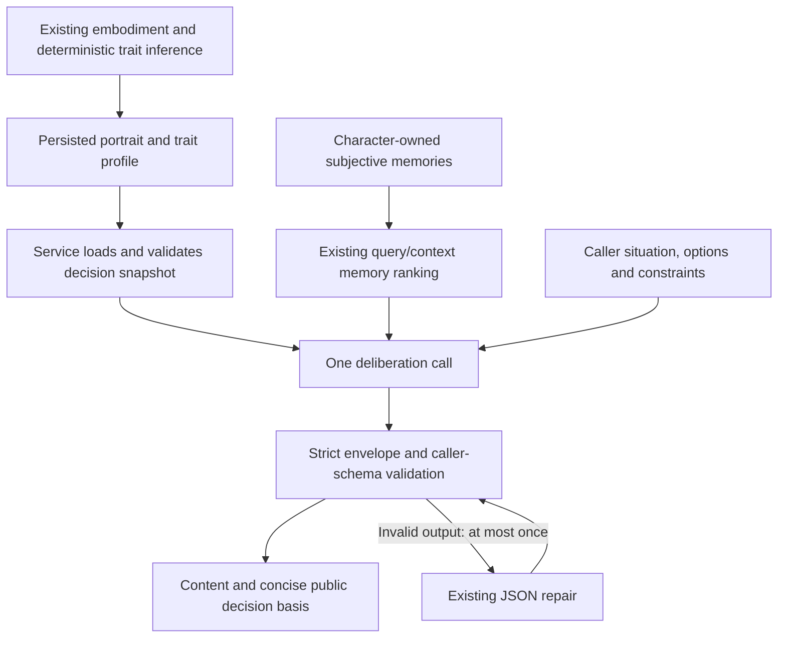

# Personality-conditioned decision-making plan

**Status:** runtime contract, required identity-mode personality projection, regression tests,
frozen baseline/situational cases, and offline comparison tooling implemented.
Live quality comparisons, reasoning promotion, and a reviewed production pilot
remain pending: configured shreckLLM health returned `ConnectError`. No
behavioral-quality improvement is established.

The decision prompt is `character-decision-v3-required-personality`; the
compact projection is `decision-personality-v1`.
Identity mode always supplies numerical context. The existing endpoint flag
`use_character_identity` is the sole personality switch; generic mode excludes
the portrait, numerical context, and memories. Reasoning defaults are unchanged.
Current contracts live in [Decision making](Query/Query.md) and
[Dispositional traits](Dispositional%20Traits.md#behavioral-identity-evaluation).
The work packages below retain the design and remaining live evaluation gates.

## Implementation verification

From `shrecknet/`, with
`SHRECKNET_MEDIA_ROOT=/tmp/shrecknet-decision-test-media`:

- `../.venv/bin/python -m pytest tests/test_character_*.py tests/test_embodiment_validation_config.py`:
  292 passed in the final shared workspace, covering snapshot fallback, evidence verification, isolation,
  manual/stale-portrait context, bounded repair, reasoning target propagation,
  isolated comparison arms, failed-trial accounting, required identity-mode context,
  and the concurrently updated model-role contracts.
- `../.venv/bin/python -m pytest`: collection blocked by existing missing imports
  in `test_architect_scene_milestone_relates_to.py`,
  `test_ontology_world_stats_endpoint.py`, and `test_scene_centric_chunking.py`
  (`app.jobs.architect.architect_v2`, `OntologyInstance`, `_normalize_scene_ranges`).

From `python_sdk/`,
`../.venv/bin/python -m pytest tests/test_character_agent_sdk.py tests/test_character_embodiment_sdk.py tests/test_character_profile_assignments_sdk.py tests/test_character_model_config_sdk.py`:
9 passed. The configured shreckLLM `/health` check failed with `ConnectError`;
no live comparison or production portrait replacement was performed.

## Objective and scope

Connect the existing behavioral identity synthesis to decision making so that
personality influences plausible choices under particular circumstances, without
becoming a deterministic policy. Treat the discussion's Whole Trait Theory,
Trait Activation Theory, and situational-strength framing as design input.
`personality_narrative_characters.pdf` was not supplied; its claims and section
references have not been verified. Shrecknet's trait registry remains the
implementation authority, and its 1–9 scores are ordinal engineering estimates,
not calibrated probabilities or population percentiles.

Assume the first release preserves public request/response schemas, the durable
job lifecycle, owner-scoped retrieval, and one substantive deliberation call.
Introduce numerical dispositions and separate Steadiness as internal context.
Evaluate reasoning through the existing model configuration before changing
production defaults. Do not redesign extraction, scoring, or persistence.

## Verified baseline before implementation

- `EmbodyAgent.generate_identity_description()` already produces conditional,
  evidence-grounded identity, psychological, and qualitative trait summaries.
  It supplies eight directional estimates and separate evidence-checked
  Steadiness, with supported motives, conflicts, and exceptions. Both draft and
  append embodiment paths use it. See the
  [behavioral identity synthesis implementation record](Behavioral%20Identity%20Synthesis%20Plan.md).
- `CharacterAgentService.load_query_snapshot()` currently returns only the
  persisted `identity_description` and the agent's owned subjective memories.
  It deliberately does not parse `trait_profile`.
- `CharacterAgentDecisionMakingJob.run()` selects at most five relevant memories
  using query/context, sends the portrait, and makes one deliberation call.
  `DECISION_MAKING_PROMPT` already discourages generic optimal choices, but does
  not explicitly define probabilistic tendencies, situational activation,
  situational strength, or Steadiness.
- `CharacterDeliberation` already contains `content` and a concise public
  `decision_basis`. Strict JSON, local caller-schema validation, and at most one
  exceptional JSON repair are implemented. No new explanation field is needed.
- `LLMModelTarget.reasoning` and `model_character_agent_deliberation` already
  exist; `ShreckLLMClient` forwards the configured reasoning flag.
- `character_identity_evaluation.py` already compares baseline/candidate
  portraits and a neutral control. It currently changes only the portrait;
  decision prompt variants, numerical context variants, and reasoning arms need
  explicit support. Live synthesis comparison and decision trials remain pending.

## Target flow and responsibilities

Inside the single deliberation call, the prompt requests three conceptual
operations: appraise the psychological demands and actual freedom of choice;
consider relevant dispositions, motives, and subjective experiences; select a
plausible response. These operations do not become additional model calls, job
stages, persisted appraisal objects, or exposed private reasoning.

## Work package 1: Define the internal personality contract

**Owners:** `character_agent_service.py`, `character_trait_analysis.py`, existing
trait schemas. `DecisionPersonalityContext`, `DecisionDisposition`, and
`DecisionSteadiness` live in `schemas/character_traits.py` because both services
and the job consume this boundary; this also avoids the job package
initialization importing embodiment back into the analysis service.

1. Extend `load_query_snapshot()` with a compact validated personality context.
   Keep loading and evidence handling in the service; the job consumes the
   projection rather than interpreting raw graph properties.
2. Supply all eight registry keys with `value` (integer 1–9 or null) and `status`
   (`unknown`, `provisional`, `supported`, or `manual`). Do not turn unknown into
   the centered value 5. Keep meanings, both poles, and construct boundaries
   sourced from `TRAIT_BY_KEY`, rather than copying them into a second registry.
3. Supply separate Steadiness with the existing `synthesis_steadiness()` fields:
   `value`, `status`, `observation_count`, `availability`, `reason`, and
   `inferred_value`. Reuse its evidence verification and the existing
   character-owned revision-ledger access/merge rules. The ledger stays on the
   backend; evidence IDs and observations are not model inputs. Check the cost
   of this lookup before considering any persisted projection or cache.
4. Preserve identity availability as a requirement. Missing profile means
   all-unknown numerical context. For an obsolete or invalid profile, preserve
   portrait-only decisions with unknown numerical context and an internal
   diagnostic; never silently convert it into valid scores. Current decision
   snapshots tolerate obsolete profile data, so adding profile parsing must not
   accidentally remove that compatibility. Malformed optional evidence makes
   Steadiness unavailable, not an invented consistency estimate.
5. Define authority explicitly: effective numerical values control dispositional
   direction; the portrait supplies established motives and individual meaning;
   memories remain subjective historical context; the current situation defines
   opportunities and constraints. A manual edit may disagree with an older
   portrait. Do not infer new motives from the edit or silently resynthesize the
   portrait during a decision. Unknown scores do not invalidate supported prose.

The model-facing projection excludes raw counts for directional traits,
confidence proxies, continuous inference, ledgers, authored background, and full
goal/aspect collections. Existing supported motives remain available through the
portrait and relevant memories. Loading active goals/aspects separately is a
possible later experiment, not required for this release.

**Completion evidence:** focused tests cover typed projection, known/unknown and
manual values, missing/obsolete profiles, stale portrait disagreement, missing
or inconsistent consistency evidence, visibility, and character isolation.

## Work package 2: Update deliberation without changing its public output

**Owners:** `decision_making.py` and `prompts.py`.

- Document the complete new input shape in `DECISION_MAKING_PROMPT`, including
  nullability, status meanings, registry definitions, and authority rules.
- Explicitly treat dispositions as tendencies rather than rules. Scores indicate
  direction and relative strength; even extreme values allow contrary actions.
  Do not fabricate numerical choice probabilities.
- Appraise relevant choices, stakes, relationships, knowledge, capability, and
  constraints before applying a disposition. Strong constraints can make
  different personalities converge. Non-diagnostic situations need not express
  every trait, and all eight traits need not influence every choice.
- Interpret options through supported fears, desires, expectations, personal
  history, and competing priorities. Avoid generic optimization, moral
  sanitization, invented conflicts, and forced differences between characters.
- Treat high Steadiness as a narrower and low Steadiness as a broader tendency
  toward variation in comparable circumstances. Respect unavailable inference
  and tentative provisional estimates; a manual value is authored direction,
  not proof of observed consistency. Do not equate Steadiness with calmness,
  per-trait variance, temperature, or a random override rule.
- Keep `content` caller-formatted and `decision_basis` a concise public reason,
  without detailed internal deliberation. Preserve existing length limits,
  validation, repair budget, and generic-mode exclusion of character data.
- Update prompt headers and the ordered module flow. Add a decision-prompt
  version for provenance; change embodiment/synthesis versions only if those
  contracts actually change.

**Completion evidence:** update payload assertions in
`test_character_agent_decision_making.py` and snapshot tests in
`test_character_agents.py`. Verify normal call count, generic mode, missing
identity failure, text/JSON output, repair success/failure, and unchanged memory
ranking and ownership. Prompt assertions establish contract coverage, not
psychological quality.

## Work package 3: Separate and measure the behavioral effects

**Owners:** extend `character_identity_evaluation.py`, its existing tests, and
frozen fixtures. Reuse the production assembly/job instead of creating another
decision engine.

First capture the current baseline. Add evaluation-local prompt and model target
overrides without mutating production globals. Make the comparison arms explicit:

| Comparison | Hold fixed | Change |
| --- | --- | --- |
| Portrait quality | Decision prompt, model/settings, situation and memories | Baseline versus behavioral synthesis portrait |
| Deliberation instructions | Portrait, numerical context availability, model/settings, situation and memories | Current versus proposed decision prompt |
| Numerical context | Proposed prompt, portrait, model/settings, situation and memories | Portrait-only versus scores plus separate Steadiness |
| Reasoning | Candidate prompt and all inputs, same model where supported | Configured reasoning off versus on |
| Neutral control | Situation, caller schema, model/settings | Existing generic mode with no character inputs |

Use opposing poles, equal scores with different supported motives, conflicting
priorities, absent motive evidence, unknown/provisional/manual scores, mixed
evidence, stale portraits, comparable repeated situations, and high/low/unknown
Steadiness. Include both unconstrained diagnostic choices and strongly
constrained or irrelevant situations. Freeze options, knowledge, context, and
memories; normal retrieval should not confound these comparisons.

Start with 20 repetitions per selected case/arm as a pilot budget, then decide
whether more trials are justified by uncertainty. Predeclare the rubric and
practical quality/latency/cost thresholds before inspecting outputs. Record
fixture, prompt, and input hashes; portrait and projection versions; exact model
target/settings; reasoning flag; supported seeds or their absence; validation
failures/repairs; latency and token usage where available. Preserve failed trials
in evaluation accounting rather than silently replacing them.

Review both action distributions and character-specific fit, with blinded human
review where practical. Look for relevant directional sensitivity, supported
motives, constraint-respecting convergence, and absence of invented psychology
or rigid stereotypes. Do not require every character to choose differently,
every extreme score to produce exceptions in a small sample, or low Steadiness
to produce arbitrary randomness. Repeated stochastic output alone does not
establish the intended behavioral distribution. Report inconclusive results.

Production identity mode always includes numerical context. Portrait-only
ablations are confined to the evaluation client to measure its effect. Review
the results and evaluate reasoning independently before changing its defaults.

## Work package 4: Documentation, pilot, and rollout

Update the current contract only when implementing the accepted candidate:

- `CharacterAgent.md`: identity authority, trait-profile use, and pipeline flow.
- `Query/Query.md`: internal personality inputs, compatibility, failure behavior,
  unchanged retrieval, call count, and reasoning configuration.
- `Dispositional Traits.md`: score interpretation, separate Steadiness, manual
  overrides, and evaluation commands/results.
- `CharacterAgent - Endpoints.md` and `python_sdk/docs/character_agents.md`:
  observable decision behavior and unchanged public schemas. Update SDK
  models/resources/examples only if a public contract actually changes.
- The existing behavioral synthesis plan: link this follow-on work and keep its
  pending live synthesis/pilot status accurate. This document does not supersede
  or mark that evaluation complete.

Use a small reviewed pilot with saved portraits and model configuration. Verify
both draft acceptance and append embodiment before normal decision queries.
Deploy compatible API/workers together. No database migration, historical scene
re-extraction, automatic portrait replacement, or memory re-embedding is planned.
The new backend evidence lookup adds query work and context adds tokens; measure
both. Enabling reasoning requires a supporting configured provider/model and
must stay within the existing job timeout and operational budget.

Rollback restores the previous decision code/configuration for future jobs;
already completed results remain historical. If the pilot deliberately replaces
portraits, save them first and restore through an authorized maintenance path
when needed. Rolling back a prompt does not restore persisted portraits.

## Delivery order and verification

1. Capture baseline and finalize typed input/authority/fallback contracts.
2. Implement compact service projection, prompt, and focused regression tests.
3. Extend evaluation arms; validate them with captured/mocked outputs first.
4. Run controlled live comparisons to measure numerical-context effects and
   decide reasoning promotion independently. Complete the pending synthesis comparison as part
   of the combined assessment.
5. Update canonical documentation, conduct the end-to-end pilot, and roll out
   only the candidate supported by the results.

Run focused tests from `shrecknet/`: `tests/test_character_agents.py`,
`tests/test_character_agent_decision_making.py`,
`tests/test_character_retrieval_isolation.py`,
`tests/test_character_identity_evaluation.py`, and
`tests/test_character_personality_evolution.py`; then the affected CharacterAgent
suite when practical. Run SDK CharacterAgent compatibility tests from
`python_sdk/`. If reasoning transport changes, test the affected shreckLLM client
and provider paths from their owning packages. Report actual outcomes and any
blocked checks rather than carrying forward historical pass counts.

Implementation is complete when code, focused tests, canonical contracts, and
evaluation evidence agree. Planning alone establishes no behavioral improvement.

## Related contracts

- [CharacterAgent](CharacterAgent.md)
- [Decision making](Query/Query.md)
- [Dispositional traits](Dispositional%20Traits.md)
- [Change and documentation policy](../../Engineering/CHANGE_AND_DOCUMENTATION_POLICY.md)
