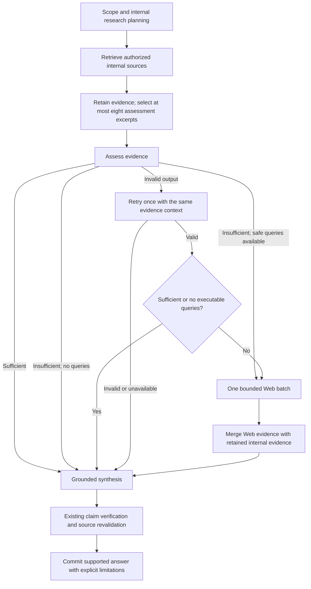

# Companion assessment and Web recovery plan

> Historical design record. Assessment, claim verification, memory voting and
> recovery-only Web policies below have been superseded by the
> [conversational simplification](./Conversational%20Simplification%20Plan.md).
> See [Companion](./Companion.md) for the current execution contract.


Status: proposed; runtime behavior has not changed. This plan replaces the
assessment/recovery portions of the current pipeline when implemented. The
[Companion guide](./Companion.md) describes current behavior; the
[simple research planner design](./Simple%20Research%20Planner%20Plan.md) remains
the starting point for scope, research questions and deterministic compilation.

## Target behavior

Web is a single recovery batch after internal retrieval and a valid assessment.
Internal sources have authority within their scope: Atlas/Elder for campaign
canon, ShreckWorld for published material, and character memory for subjective
history and beliefs. Web cannot supply missing private campaign canon or silently
override campaign evidence. Retrieval success does not establish factual support.



Conversation-only turns and scope clarification keep their existing paths. This
change adds no second assessment after Web, local recovery round, or assessment
loop. Existing synthesis repair/verification is a separate publication safeguard.

## Assessment contract

The model returns exactly two required fields, with no extra keys:

```json
{"sufficient": false, "web_queries": ["RuneQuest Roleplaying in Glorantha Telmori character creation rules"]}
```

```json
{"sufficient": true, "web_queries": []}
```

Use a job-local `EvidenceAssessment` in `query_contracts.py`. Require a strict
Boolean for `sufficient`: reject strings and integers rather than coercing them.
Require `web_queries` to be an array of at most two strict strings, stripped of
surrounding whitespace, each 1–500 characters. Reject malformed envelopes,
oversized lists and blank queries. For a valid sufficient response, discard all
queries before execution. Normalize and deduplicate queries deterministically.

`sufficient=false` with `web_queries=[]` is valid. It means no useful safe public
lookup is proposed, including a gap that only private campaign records could fill.
Do not manufacture a query or infer that the answer is impossible in general.
Conflicting or inapplicable evidence also makes the assessment insufficient;
only propose Web queries where external information can help resolve the gap.

Assessment input contains the resolved user question, all planned information
needs, validated scope/system/edition context, selected excerpts, compact tool
outcomes and whether Web recovery is available. Source IDs may remain in input
for provenance; the assessment never returns IDs, support quotes, per-need
statuses, confidence, coverage objects, tool calls or follow-up tasks.

## Retrieval and evidence selection

Proposed fixed limits for the first implementation:

| Boundary | Limit |
| --- | --- |
| Atlas/Elder evidence | Five unique records per turn across all Atlas calls |
| ShreckWorld evidence | Five unique records per turn across all book calls |
| Character memory evidence | Five unique records per turn across all memory calls |
| Assessment input | Eight excerpts across all sources, also bounded by the existing token budget |
| Web recovery | One batch, at most two distinct queries |
| Web evidence | Five unique records total across both queries |

The three primary internal tools therefore contribute at most fifteen records.
Chronicle remains an authorized internal source with its own five-record cap;
existing bounded Foundry snapshots and attachments remain usable. These additional
sources share the eight-excerpt assessment limit; fifteen is not a universal
total when they are present. Preserve existing admission and authorization rules.

Set adapter request limits to five where supported and enforce aggregate source
caps in the backend as well. Several research tasks may query the same tool;
allocate its five admitted records across needs after the calls finish, independent
of completion order. Web results also share one aggregate cap, with fair allocation
between queries. Limits apply to evidence records, not only provider requests.

Keep separate representations: bounded retrieval outcomes/full source records,
the admitted evidence pool, and model-specific context projections. Do not delete
admitted evidence because it did not fit the assessment input. Preserve original
IDs, references, exact passages, scope, revision and navigation metadata for
citations, source revalidation and Answer Breakdown. Record exclusions at each
boundary; merging Web must never evict internal records.

Extend `evidence_context.py` with deterministic need-aware selection. Reserve one
relevant candidate per information need before filling remaining slots. Use
existing need associations, query overlap and within-source rank; do not compare
raw scores across different tools as though they have one scale. Break ties using
source diversity, stable source rank and evidence ID. Need associations are
retrieval intent, not semantic proof. Skip candidates that cannot fit and continue
with others; record uncovered needs and token omissions. Preserve whole compact
records or exact contiguous excerpts without rewriting their underlying sources.

The eight-excerpt restriction applies only to assessment. Synthesis receives a
separately budgeted, citation-ready projection of the combined pool; verification
must see every passage used by the draft. The existing twenty-record main-tool
pool fits fifteen internal plus five Web records, but auxiliary evidence requires
explicit retention accounting. Replace destructive collection-time token pruning
with model projection limits; retain existing bounded adapter/attachment payloads.

## Execution and failure rules

1. Keep scope resolution, continuation, access checks, memory relevance and the
   simple question/source planner. Exclude Web from initial planner choices and
   reject it in compilation, including technical fallback and no-local-tool paths.
   A research request with no executable internal call still reaches assessment.
2. Retrieve selected internal tools concurrently, preserving successful siblings
   when another tool fails. A timeout, empty result or unavailable source becomes
   assessment input; it never independently triggers Web.
3. Freeze the selected assessment input and call `ASSESS` once. On invalid JSON or
   schema validation failure, retry once with the identical evidence, needs and
   outcomes. A concise repair instruction may identify the contract error. Keep
   the current bounded retry timeout and overall deadline; do not shrink the
   evidence to four records or suppress legitimate queries on the retry. Provider
   outages/timeouts may use the same single retry budget if time remains.
4. After a valid insufficient response, execute its nonempty safe queries only
   when Web is configured, available and recovery is enabled. Apply
   `min(2, companion_recovery_max_calls)` and one batch regardless of a larger
   saved call cap. Preserve the documented request-tool policy rather than
   silently changing Web permission semantics during this redesign.
5. Make safe public-query generation part of the assessment prompt. Port the
   existing `PUBLIC_RECOVERY` rules for private names, campaign events, histories
   and system/edition metadata. Do not send private records or the original
   question to the Web provider as context. Backend validation handles bounds,
   duplicates and known private identifiers; it must not claim that string checks
   prove privacy. Reject queries failing those checks without a raw-query fallback.
   The standard path has no separate public-query rendering LLM call. Private-only
   and mixed private/public cases require explicit semantic evaluation before rollout.
6. Merge actual provider snippets and references, never generated search summaries.
   Proceed directly to synthesis, passing the original assessment as a pre-Web
   decision plus actual recovery outcomes. Do not label it a post-Web review.
7. If assessment fails twice, set `assessment_unavailable`, skip Web, and attempt
   grounded synthesis with retained internal evidence and explicit uncertainty.
   Keep claim verification and deterministic source checks. If synthesis or
   verification cannot produce a supported answer, retain the existing attributed
   extractive fallback. With no evidence, return an honest limitation.

Keep existing tool, HTTP, retrieval-round and turn deadlines, cancellation,
heartbeats, leases and final source/asset authorization checks. Recalculate the
required-turn-budget helper for one assessment plus one optional retry; do not
lower administrators' saved timeouts or introduce another startup migration.

## Verification and compatibility

`sufficient` controls recovery; it does not certify the final answer. Preserve
the existing `Draft`, `Verification`, exact-quote checks and citation resolution.
Synthesis must acknowledge unanswered needs, contradictions, failed/irrelevant Web
results, subjective memory and incomplete indexing. Do not invent per-need support
from a global Boolean or mark all needs supported when retrieval returned records.

For this first change, allow `coverage="complete"` only when the internal
assessment was valid and sufficient, all final claims pass verification, and the
existing failure/readiness/omission checks pass. Recovery and assessment-outage
answers conservatively remain `partial`, even if their delivered claims are
supported. Successful Web execution alone cannot upgrade coverage. This avoids
adding another answer-completeness model contract; finer post-Web completeness is
outside this plan.

Version the new assessment in result diagnostics. Inspect all raw `result` and
Answer Breakdown consumers before replacing the saved assessment payload:
the typed `AnswerDetailsRead` has no assessment field, but turn results are open
dictionaries and examples inspect them. Preserve legacy saved turns unchanged;
new consumers accept both legacy assessment objects and the two-field form.
Retire active `AssessmentProposal`/`compile_followups` dependencies after auditing
callers; retain legacy contracts only where historical decoding actually needs
them. Never synthesize legacy support/confidence records to mimic compatibility.

No route, request payload, database schema, graph rewrite or re-embedding change
is expected. Document the diagnostic payload transition and conservative coverage
semantics explicitly. Drain active turns and deploy contracts, prompts and workers
together; rollback uses the previous worker/prompt bundle without rewriting history.

## Implementation sequence and acceptance

1. **Contract and planning:** add `EvidenceAssessment`, update planner/compiler
   guards and add strict contract tests. Preserve existing scope/memory behavior.
2. **Evidence ownership:** update `integrations/companion/retrieval.py` and
   `jobs/companion/evidence_context.py` for five-record source caps, fair aggregate
   selection, retained full records and separate eight-excerpt assessment context.
3. **Orchestration and prompts:** simplify `query_pipeline.py` and `recovery.py`;
   remove pre-assessment Web, follow-up compilation and post-Web reassessment.
   Update prompt definitions, headers and module flow in execution order. Both
   assessment attempts have the full two-field output contract. Synthesis and
   verification consume the new pre-Web assessment with explicit limitations.
4. **Publication and operations:** update completeness logic, diagnostic version,
   budget calculation and saved-turn compatibility. Preserve rich-response,
   source revocation, cancellation and lease behavior.
5. **Documentation and validation:** update `Companion.md`, `Frontend API.md`,
   `Model Configuration.md`, `Validation.md`, affected SDK docs/examples and the
   existing unreleased retrieval changelog. Update older design records to point
   to the new implemented flow only when it is delivered.

Focused regressions must cover:

- Strict Boolean/query validation, whitespace, duplicate and excessive queries,
  sufficient responses discarding queries, and valid insufficient/empty output.
- Sufficient internal evidence produces zero Web calls; empty/failed internal
  retrieval still assesses first; malformed assessment never triggers Web.
- One successful retry with identical evidence may trigger Web; two failures
  preserve source metadata and attempt synthesis before extractive fallback.
- Exactly one assessment decision and at most one retry, no post-Web assessment,
  at most two Web queries/five results, and disabled/unavailable recovery.
- Five records per source across multiple tasks; eight excerpts preserve multiple
  needs and source diversity; selection is independent of completion order;
  token exclusions do not erase full retained records or original references.
- Private campaign gaps yield no Web lookup; mixed questions search only public
  material; unknown editions and private metadata do not become public queries.
- Failed, irrelevant or conflicting Web evidence preserves uncertainty and partial
  coverage; factual claims remain cited and verified; no invented source IDs.
- Chronicle/Foundry/attachments, selected-character memory isolation, source
  revocation, rich responses, historical turns, deadlines and cancellation remain
  compatible. Replace tests asserting the superseded recovery behavior.

Run focused assessment/recovery/planning tests first from `shrecknet/`, then the
affected Companion, configuration and source-adapter suites. Run SDK tests from
`python_sdk/` when result parsing/examples change. Use the environment setup in
[Validation](./Validation.md). Evaluate a curated set of public, private, mixed,
multi-need, conflicting and wrong-edition questions against real models before
deployment; unit tests cannot establish semantic sufficiency or privacy quality.
Report actual commands/results and remaining deployment checks at implementation
handoff. This planning-only change does not claim those checks have run.
