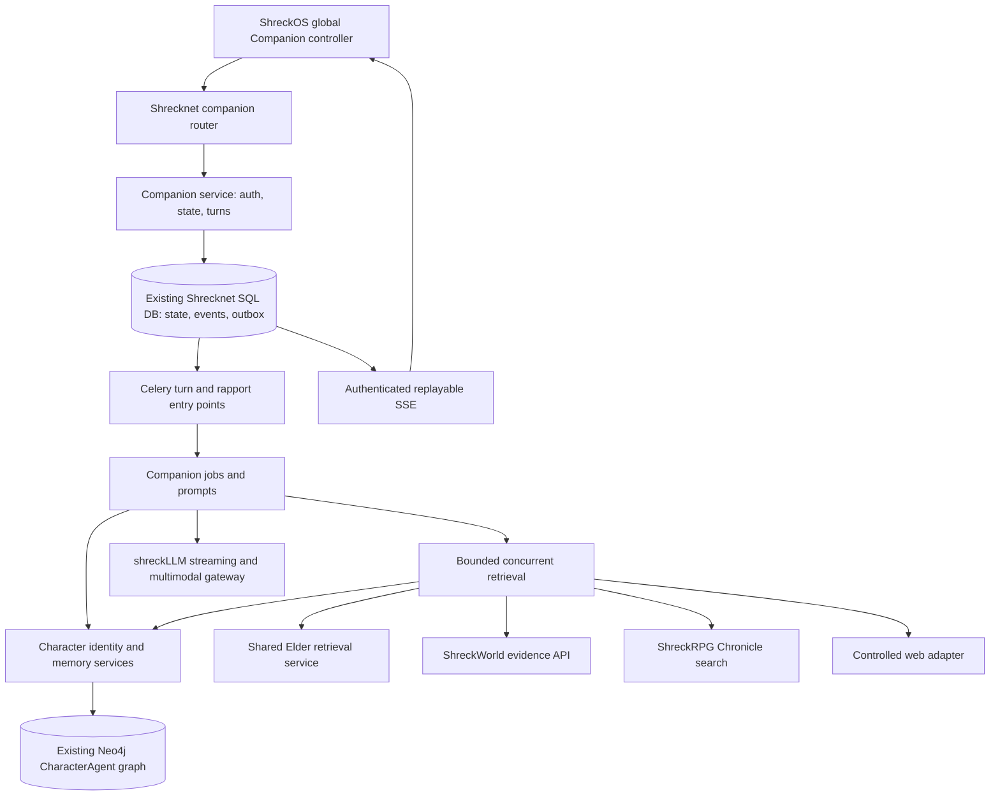

> Design baseline and acceptance checklist. The code now implements the core integration;
> see [Character Companion](Companion.md) for the current contract, deployment gates
> and explicit remaining work. This plan is not a claim that every acceptance gate passed.

# Unified Character Companion — backend architecture and delivery plan

Status: proposed design, 2026-10-20. This document does not describe released
functionality. Implementation begins with the milestones below after this design
and migration strategy have been reviewed. The HTTP and model contracts are in
[Frontend API](Frontend%20API.md) and [Model Configuration](Model%20Configuration.md).

## Scope and decisions

Bring Character Companion orchestration and user-specific persistence into
Shrecknet. Keep Shrecknet's existing users and Neo4j `CharacterAgent` identities
authoritative. Keep ShreckWorld and ShreckRPG as independent domain services.
Use shreckLLM for provider access, including new incremental streaming and image
support. Do not introduce another identity store or a new agent framework.

The backend deliverable includes frontend-consumable selection, rapport, chats,
attachments, turn recovery/cancellation, SSE, capability discovery, and four
independent Companion Agent model settings. ShreckOS implementation is a separate
consumer milestone; its contracts are part of this backend plan. Notifications,
autonomous interactions, personality editing, and a separate long-term relationship
memory system are outside this feature. Preserve existing notification data and
operation during the companion migration.

One global selection means **zero or one selected character per user**, with
exactly one when selected. A conversation belongs permanently to one user/character
pair; switching the selection never moves, deletes, or merges it. The current
authorization rule is public characters for non-admin users and public/private
characters for admins. Do not infer private access from `created_by_user_id`.

## Audit provenance and limits

Read-only source audit:

| Repository | Audited revision | Scope |
| --- | --- | --- |
| Local `pablovin/Shrecknet` | `ab8ac88dff368cb6b8e9aa6e7413b04a226a711f` | API, schemas, services, graph snapshots, memory ranking, jobs, config, LLM gateway, ShreckWorld, SDK, tests, documentation |
| `pablovin/shreckCompanion` | `9606f867f854f27241a09e97b0a9fce16d20e151` | Backend selection, relational models/store, turn lifecycle, specialist clients, prompts, configuration, tests; frontend source layout/API surface |
| `pablovin/ShreckRPG` | `55faf717c1f5c75540a8133eada12cf6670fd2ae` | Chronicles routers/contracts/repository/services, browser auth, ShreckOS shell and existing companion surfaces |

Remote source was read through the connected GitHub application. The historical
`pablovin/ShrecknetFrontend` repository name resolves to `pablovin/ShreckRPG`;
ShreckOS is under `shreckos/` there. No frontend application is tracked in this
Shrecknet checkout. This is a source audit, not a running deployment, data-volume,
provider-capability, security penetration, or latency audit. Production schema
versions, legacy backups, and installed model capabilities require preflight.

### Reuse matrix

Paths below are relative to the repository named in the first column.

| Existing owner and implementation | Finding | Decision |
| --- | --- | --- |
| Shrecknet `app/services/character_agent_service.py`: `get_agent`, `ensure_queryable`, `load_query_snapshot` | Neo4j identity, active-status and public visibility checks already exist. Snapshot contains persisted `identity_description`, owned perspectives and validated personality context. | Retain authoritative identity/access checks. Split bounded identity loading from memory loading; the existing snapshot loads all perspectives. |
| Shrecknet `app/services/character_trait_analysis.py`: `decision_personality_context`; `app/schemas/character_traits.py` | Effective directional scores, pole definitions, manual/inferred state and separately qualified Steadiness already exist. | Reuse the typed projection and registry; do not decode legacy profile fields in a second implementation. |
| Shrecknet `app/jobs/character_agent/memory.py`: `render_memory_document`, `select_relevant_memories` | Deterministic embedding/lexical ranking over owned perspectives with lexical fallback. Returned prompt projection intentionally strips IDs. | Extract reusable retrieval ownership to `services/character_memory_service.py`; add an evidence projection retaining IDs/provenance. Preserve the decision prompt projection and behavior. |
| Shrecknet `app/tasks/character_agent_decision_making.py`, `app/jobs/character_agent/decision_making.py` | Single decision call already consumes identity and personality context. | Retain public contract; use the shared memory service without invoking decision-making for Companion recall. |
| Shrecknet `app/jobs/elder/query_v2.py`, `executor.py`, `grounding.py`, `evidence.py`; `app/integrations/retrieval/neo4j_retriever.py` | `mode="context"` skips synthesis, but usually still calls the Elder planner. Existing executor, grounding and evidence assembly provide the needed graph mechanisms. | Extract a retrieval service used by Elder and Companion. Use deterministic bounded plans on the ordinary path; reuse Elder planning only for complex graph requests. Do not call an API router from a job. |
| ShreckWorld `app/api/routers/shreckworlds.py`, `app/schemas/shreckworld.py` | `POST /shreckworlds/{id}/query` defaults to `mode="evidence"`, supports one/many book IDs and single/planned retrieval. | Retain service ownership; default Companion calls to evidence/single retrieval. Preserve page/block/source hashes and coverage. |
| ShreckWorld `app/services/query.py` | Web policy fields exist, but trace reports `web_search: "not_implemented"`. | Introduce a controlled web-search integration in Shrecknet; existing policy fields do not constitute an implemented provider. |
| ShreckRPG `app/api/routers/chronicles.py`, `repositories/chronicles.py`, `services/note_policy.py` | Authorized libraries and revisioned content exist. No search route appears in the audited Chronicles router. Content is a document string, without a stable persisted section-ID contract. | Extend the RPG owner with search and revision-scoped section references; do not copy its database or retrieve an unrestricted library and filter later. |
| Shrecknet `app/models/personal_companion_agent.py`, `api/routers/personal_companion_agents.py` | Existing `/users/me/companion` is a SQL user-owned name/avatar/writing-style persona, not a CharacterAgent selection. | Preserve these routes and schemas during rollout; use additive `/users/me/character-companion` routes. No automatic persona-to-character conversion. |
| Shrecknet `app/jobs/personal_companion/`, `tasks/companion_orchestrator.py`, `utils/companion_orchestrator_store.py` | Routing plus Elder/Librarian fan-out, Celery jobs, JSON chat files and polling already exist; no new global CharacterAgent rapport contract. | Reuse relevant failure/citation tests and job patterns. Do not adopt the filesystem store as the new authoritative transactional state. Keep legacy clients working. |
| shreckCompanion `app/persistence/store.py`, `models/relationships.py`, `service.py` | One selection per user; rapport per user/character; switch/reselect preserves data. Six integer dimensions 0–100, defaults 25/20/20/0/10/0, confidence threshold 0.6, delta limits ±2 and strain ±5. Daily history overwrites that day's snapshot. | Retain dimensions, initial values and conservative movement. Replace update persistence with per-turn versioned audit, ordering and idempotency. Import daily snapshots without inventing turn-level history. |
| shreckCompanion `app/services/turns.py`, `services/specialists.py` | In-process live turns and post-response `asyncio.create_task` rapport; concurrent specialist requests; full synthesis followed by character rendering. | Retain direct/tool branching concepts. Replace lifecycle with durable turns/outbox and one embodied synthesis call. Add source deadlines; do not port all sequential calls. |
| shreckCompanion `models/character_agents.py`, `services/context.py`, `jobs/rapport_update/` | Identity projection uses background/profile/aspects/goals, rather than Shrecknet's current three summaries; rapport prompt lacks explicit canonical character identity. | Rebuild prompt inputs from authoritative typed identity and traits. Rapport must evaluate from that same character perspective. Do not import continuity buckets as relationship memory. |
| shreckCompanion `app/api/routes.py`: `get_current_user_id` | User-facing local identity accepts `X-Shreck-User-Id` or a configured default. Admin config separately checks Shrecknet. | Do not carry this local authentication contract into Shrecknet. Require validated Shrecknet credentials for every user resource. Legacy ownership needs verification before import. |
| shreckCompanion `app/persistence/store.py`: `_migrate_to_character_agents`, `_reset_v1_for_v2` | Existing historical migrations delete session/turn/state data and JSON chats; current startup also drops `turn_stage_jobs`. | Never run legacy initialization against migration input. Read copies with read-only SQLite connections; recover older data only from actual backups. |
| shreckLLM `app/schemas.py`, `api.py`, provider clients; Shrecknet `integrations/llm/shreckllm_client.py` | Chat content is string-only; completed `/chat` and `/chat/jobs` responses, with no token-stream route in the audited API. Ollama explicitly uses `stream: false`. | Extend existing gateway/client contracts additively for typed image parts, provider streaming, abort and capability reporting. Preserve existing jobs and text callers. |
| Shrecknet `core/config_store.py`, `api/routers/configurations.py`, `api/routers/llm_status.py` | Typed targets, reasoning controls, admin schema groups, catalog and status exist. Current model status omits legacy orchestrator targets. | Add Companion roles to the complete config/status/prewarm path and SDK. No second configuration database or user-supplied arbitrary provider request. |
| ShreckOS `features/nexus/NexusDesktop.tsx`, `features/atlas/AtlasCompanions.tsx`, `companionContext.ts`, `features/shreckworld/KnowledgeCompanion.tsx` | Nexus mounts world-scoped Elders; ShreckWorld has a separate knowledge chat. Active Atlas world tracking and authenticated HTTP transport exist. | Add one shell-owned Character Companion controller with contextual mounts. Retain existing specialist surfaces through staged rollout; do not confuse their identities with the user's selected character. |

Relevant existing regression owners include Shrecknet
`tests/test_character_agent_decision_making.py`, `test_character_agent_model_config.py`,
`test_personal_companion_agents.py`, `test_personal_companion_orchestrator.py`;
SDK `tests/test_character_model_config_sdk.py`, `test_personal_companion_sdk.py`;
shreckCompanion `tests/test_character_agents.py`, `test_relationships.py`,
`test_four_model_pipeline.py`, `test_stage_ownership.py`; RPG
`tests/test_chronicles.py` and `test_browser_session_auth.py`. Existing assertions
are reuse references, not proof that the proposed behavior already passes.

## Component ownership



Proposed Shrecknet owners:

| Layer | Modules and responsibility |
| --- | --- |
| Transport | `api/routers/character_companion.py`: mapping, dependencies, status codes, SSE framing only; register in `app/main.py` |
| Boundary schemas | `schemas/character_companion.py`, `schemas/companion_evidence.py`: HTTP, evidence, events; job-local LLM schemas stay beside jobs |
| Services | `services/character_companion_service.py`: selection/chat/turn orchestration; `companion_rapport_service.py`: validation/reset/order; `character_memory_service.py`: authorized perspective recall; `elder_retrieval_service.py`: shared graph retrieval |
| Persistence | `models/character_companion.py`, `repositories/character_companion_repository.py`: SQL state, constraints, paging, conditional updates and outbox/event transactions |
| Jobs | `jobs/companion/`: router, retrieval coordinator, synthesis, rapport schemas/prompts; deterministic validators and budgets |
| Tasks | `tasks/character_companion.py`: dispatch/retry/cancellation integration, delegate rules to services/jobs |
| Integrations | Extend `integrations/llm/shreckllm_client.py`; add narrowly scoped ShreckWorld, Chronicles and web adapters under `integrations/` |
| SDK | `python_sdk/shrecknet_client/`: additive typed `character_companion` resource, SSE parser, models/config helpers and runnable examples |

Use existing `AsyncSessionCompat`, migration registration in `db/init_db.py`,
SQLAlchemy repositories, Redis/Celery, embedding runtime and job instrumentation.
Keep authoritative turn state and its outbox in the main SQL database: the separate
jobs database cannot participate in the same completion/rapport transaction.
BackgroundJob mirrors are diagnostic, never the source of completion truth.
Use short SQLite-compatible conditional updates; do not require `SELECT FOR UPDATE`
or hold a transaction while making network/LLM calls. Never share one SQLAlchemy
or Neo4j session across concurrent tool coroutines.

## Persistent state and invariants

Proposed tables, all with UTC timestamps and owner indexes:

| Table | Keys and stored contract |
| --- | --- |
| `character_companion_selections` | `user_id` PK/FK; nullable `character_agent_id`; monotonic `version`, `selected_at`, `updated_at`. Retain a cleared row so versions never reset. |
| `character_companion_rapports` | Composite PK `(user_id, character_agent_id)`; six checked integer scores 0–100; `version`, `generation`, `last_evaluated_sequence`, `next_completion_sequence`, `interaction_count`, `last_turn_id`, timestamps. |
| `character_companion_chats` | UUID PK; immutable user/character pair; optional default typed scope; title; revision; soft-deletion/purge state. |
| `character_companion_turns` | UUID PK; chat/owner; idempotency key and normalized request hash; admitted selection version; identity/config versions; rapport generation/version used; state, cancellation flag, lease/fencing token; final answer/manifest; pair completion sequence; error and timings. |
| `character_companion_messages` | UUID PK; turn/chat; user or assistant role; content/attachment links; final/draft status. Unique `(turn_id, role)` for authoritative exchange. Interim comments are events, not final assistant messages. |
| `character_companion_evidence` | Turn/evidence ID unique; normalized provenance, excerpt, source revision, permission scope fingerprint and coverage. No credentials or arbitrary executable URLs. |
| `character_companion_attachments` | UUID PK; owner, private storage key, MIME/dimensions/hash/size, expiry, deletion state; link to admitted turn. |
| `character_companion_events` | User-scoped monotonically allocated sequence, event type/version, turn/chat IDs and payload; stable SSE ID; committed in order. |
| `character_companion_rapport_audit` | Unique completed turn ID; pair/generation/sequence; before/after versions/scores, proposed/applied deltas, confidence/evidence references, disposition, model/prompt version, timestamp. Also typed reset/import records with distinct IDs. |
| `character_companion_outbox` | Unique `(kind, aggregate_id, generation)`; dispatch/lease/attempt/retry state for turn execution, rapport evaluation and cleanup. |
| `character_companion_imports` | Source installation, legacy type/key, destination key, checksum and batch; unique source mapping for resumable imports. |

SQL has a user FK but cannot have an FK into Neo4j: character IDs remain opaque
graph references. Deletion/archive/private visibility makes the selection
unavailable; retain user-owned chats/rapport without copying canonical identity.
`GET selection` returns a redacted unavailable state if the graph record is no
longer authorized. Graph outages return `503`, not a false deletion. Only explicit
selection changes/clear affect the selection version. Reselecting the same character
is idempotent and preserves its timestamp/version.

Selection writes require an expected version, including version 0 for an absent
selection. Concurrent tabs use database CAS; losers get `409` and refetch. New
turns must name the current selection version and their chat must match it.
An admitted turn stays bound to its original character when selection changes;
switching alone does not cancel it. Explicit cancellation can stop it. Recheck
character status/access at execution and before final commit. Access revocation
prevents further source delivery/final publication; selection changes do not grant
access to a previous chat's character.

Allow one executing turn per chat, enforced by a database active-turn reservation;
return `409 chat_busy` for overlapping submissions. Separate chats can run in
parallel. Pair-level rapport ordering is independent of chat execution ordering.
Messages, turn finalization, completion sequence, terminal events and rapport
outbox insertion commit atomically. Worker deliveries can repeat; completion CAS,
fencing tokens and unique constraints prevent duplicate messages or side effects.

## Rapport contract

Retain the six existing dimensions and their defaults:

| Key | Meaning from the character's perspective | Initial | Max movement per completed turn |
| --- | --- | --- | --- |
| `connection` | Sense of interpersonal connection | 25 | ±2 |
| `coordination` | Ability/willingness to work together | 20 | ±2 |
| `trust` | Evidence-based reliance on the user | 20 | ±2 |
| `familiarity` | Supported knowledge of shared interactions | 0 | ±2 |
| `openness` | Willingness to disclose or engage | 10 | ±2 |
| `current_strain` | Present relational tension; higher means more strain | 0 | ±5 |

These are modeled relational states, not measurements of the user's personality
or emotions. They never mutate canonical traits, summaries, aspects or goals.
Do not automatically increase trust for praise, agreement or repeated visits.
Every committed complete exchange is evaluated, including all-zero changes.
Partial/cancelled/failed exchanges receive no rapport evaluation. Here “delivered”
means a final answer has been committed and made recoverable; browser receipt
cannot be guaranteed or used as a transaction boundary.

Proposal input: immutable completed user/assistant exchange, canonical character
identity/traits snapshot used for that turn, current pair state and version,
generation and completed-turn sequence. No tool output is admissible as standalone
relationship evidence. Image references may contextualize the user's exchange;
inferred user psychology is never evidence. Output is strict JSON:

```json
{
  "turn_id": "turn-uuid",
  "base_version": 4,
  "generation": 0,
  "completion_sequence": 3,
  "changes": [
    {
      "dimension": "trust",
      "delta": -1,
      "confidence": 0.8,
      "evidence": [{"message_id": "user-message-uuid", "quote": "I broke that promise."}],
      "reason": "An acknowledged broken commitment matters to this character."
    }
  ]
}
```

`changes` may be empty; each dimension occurs at most once. Delta is a strict
integer, dimension is one of the six keys, confidence is finite in [0,1]. Backend
binds/checks all identifiers, requires evidence from that exchange and verifies
quote membership. Only changes with confidence >=0.6 and nonempty admissible
evidence can apply; clamp movement to the table and final score to [0,100]. Record
requested versus applied movement, including saturation and rejected proposals.
Evidence membership is a deterministic check, not proof of psychological validity;
character consistency needs evaluation fixtures and human review.

Allocate completion sequence transactionally per pair at successful final commit.
A durable worker leases the next pending sequence and evaluates it against the
latest applied state. It must not evaluate sequence N+1 against a state that has
not settled N. Network calls run outside transactions; apply with CAS on the
pair version/generation/cursor and worker fence. A stale proposal is discarded
and re-evaluated, never blindly rebased. Duplicate turn deliveries return the
existing audit. Audit/no-change/cursor advancement/version increment commit
together; `interaction_count` increments exactly once per evaluated exchange.

Use bounded retry/backoff for failed evaluation. After the retry limit, write an
audited `evaluation_failed` no-op and advance the cursor so one poison turn cannot
block all future rapport. A late result cannot replace it. Expose pending/failed
counts and allow operational retry before terminal settlement. The visible answer
never waits; subsequent turns receive the latest applied version plus pending count.

Reset restores defaults, increments version and generation, and writes a reset
audit. Pending and in-flight turns admitted in an older generation are settled as
`superseded_by_reset`; they cannot restore previous scores. New turns use the new
generation. Preserve chat history and historical audit; do not re-evaluate old
turns on reset. Legacy relationship summaries/snapshots are import records, not
new model-maintained relationship memory.

## Retrieval contracts

All five adapters implement an internal retrieval-only interface:

```text
retrieve(query, authorized_scope, principal, limit, deadline, context) -> RetrievalResult
RetrievalResult = {tool, status, evidence[], coverage, warnings[], elapsed_ms}
status = ok | empty | partial | unavailable | timed_out | forbidden
```

`principal` and effective scope are supplied by backend services, never the model.
Scope distinguishes SQL world ID, ontology ID, ShreckWorld UUID, book UUIDs,
Chronicle integer IDs and character ID; they are not interchangeable. Resolve
world/ontology mapping explicitly. Explicit IDs outside authorized scope fail
validation; optional unavailable tools produce partial-result diagnostics. Reject
unsupported tools and scope expansion before execution.

Common evidence shape (all keys required; optional values represented by null):

```json
{
  "evidence_id": "character_memory:agent-id:perspective-id:revision",
  "source_id": "perspective-id",
  "source_type": "character_memory",
  "title": "Remembered meeting",
  "excerpt": "I believed the promise at the time.",
  "structured_evidence": null,
  "reference": {"character_agent_id": "agent-id", "perspective_id": "perspective-id", "scene_id": "scene-id", "revision": "revision"},
  "relevance": {"score": 0.83, "method": "hybrid", "rank": 1},
  "coverage": {"status": "partial", "warnings": []},
  "epistemic_category": "subjective_memory",
  "retrieved_at": "2026-10-20T12:00:00Z",
  "scope": {"ontology_id": 12, "character_agent_id": "agent-id"},
  "navigation": {"kind": "character_perspective", "resource_id": "perspective-id", "parent_id": "agent-id", "location": null}
}
```

`source_type`: `atlas`, `shreckworld`, `chronicle`, `web`, `character_memory`,
or `user_attachment` (the last is supplied input, not a sixth retrieval tool).
Epistemic categories: `canonical_world`, `document_evidence`, `chronicle_record`,
`external_web`, `subjective_memory`, `user_provided`. Relevance scores are not
comparable across adapters and are not factual confidence. Coverage status:
`complete`, `partial`, `unknown`; it describes the requested retrieval scope,
not omniscient coverage of a topic. An excerpt or structured evidence must exist.
Stable evidence IDs include source revision/location, with no user secrets.
Permission validation is recorded internally with principal/scope fingerprint,
policy version and validation time; public projection contains only authorized
scope/navigation. Never expose an `allowed: true` field as a reusable permission.

Source-specific discriminated `reference` and `navigation` schemas preserve:

| Adapter | Retrieval and references |
| --- | --- |
| Atlas | Shared Elder grounding/executor/evidence service; authorized ontology set intersected with explicit page/world scope. Node IDs/labels, relationship endpoints, source/scene/milestone provenance and revision fingerprint. No conversational synthesis. Complex graph planning is an explicit timed/costed branch. |
| ShreckWorld | Authenticated `POST /shreckworlds/{shreckworld_id}/query` with `mode="evidence"`, `retrieval_strategy="single"`; omit book filters for the full world, or supply validated `library_item_ids`. Keep document hash, passage/chunk/block IDs, 1-based PDF pages, printed-page labels and bounding boxes where available. Never infer broader coverage from truncated results. |
| Chronicles | Proposed RPG `POST /chronicles/search` applies `note_policy` and sharing filters before ranking. Bounded lexical search over title/content/authorized responses initially; no new vector infrastructure required. Preserve Chronicle ID, revision, response/session-note origin when available, heading path and text offsets. Introduce deterministic revision-scoped section IDs; no claim of stable cross-edit sections. Reuse original permission policy, including ownership/sharing/edit capability distinctions. |
| Web | New provider adapter behind a configured provider interface; disabled by default. Titles, normalized HTTP(S) URLs, snippets/excerpts and retrieval time. Strict query/result/rate limits, no internal credentials; reject private-network URLs and unsafe redirects if fetching pages. Never send full private chats or documents in web queries; use only the minimum query terms. Web information is external, even when it describes a fictional world. Provider selection/credentials are deployment configuration, not hard-coded model-generated URLs. |
| Character memory | Only `(selected CharacterAgent)-[:HAS_PERSPECTIVE]->(ScenePerspective)` aggregates. Preserve subjective emotions, beliefs, source type, historical chronology, perspective/source/scene IDs. Ranking uses existing embeddings/lexical fallback. Graph relationships may supply provenance IDs/time only; never substitute objective Scene text or another agent's perspective. Decision-making retains its current ID-free prompt projection. |

The new RPG search contract and section resolution must ship before enabling that
tool. Do not scrape all Chronicles through list endpoints. There is no need for
a public Companion-specific Elder retrieval endpoint: both callers live in
Shrecknet. Shared extraction must keep Elder's existing context/answer output.

## Ordered conversation pipeline and LLM contracts

1. **Admission, backend only:** authenticate; gate feature/AI availability; validate
   owner/selection/version/chat/scope/images/idempotency; reserve chat turn;
   persist request, `turn.created` and turn-dispatch outbox; return `202`.
2. **Context, backend only:** worker revalidates user/character access and loads
   bounded persisted identity, effective trait context, latest rapport with pending
   count, recent completed exchanges and typed active-page context. Cache identity
   by character revision/trait version. No embodiment or trait consolidation jobs.
3. **Image interpretation, optional:** when images must inform retrieval, use the
   configured multimodal synthesis target for one bounded structured interpretation
   before routing. Output observations with attachment IDs, visible text, uncertainty
   and retrieval terms. Treat this as a measured extra call. Images needing no
   retrieval can go directly to multimodal synthesis. Never run image understanding
   on text-only turns.
4. **Stage 1 — route/frame:** deterministic greetings/conversation/follow-up/source
   references first. Reuse prior authorized evidence when query/scope/revision fit.
   One optional lightweight model call for ambiguity; output
   `{needs_retrieval, requests:[{tool,query,scope_ref,limit}], reuse_evidence_ids, reason}`.
   Tool enum is exactly the five adapters; limits/scopes are checked by backend.
   Max one request per tool initially, at most five; complex graph subplanning
   remains bounded. Routing reasons are concise diagnostics, not hidden reasoning.
5. **Retrieval, backend only:** run selected adapters concurrently, with independent
   sessions, semaphores, deadlines and result budgets. Emit progress/evidence as
   each finishes. A failed adapter never cancels healthy siblings. Preserve empty,
   partial, stale and failed coverage; no fabricated fallback evidence.
6. **Stage 2 — synthesis/reason and render:** one primary model call receives
   identity's `identity_summary`, `psychological_summary`, `personality_traits`,
   typed effective directional scores/definitions/poles, qualified Steadiness,
   rapport, conversation/topic, page context and bounded evidence/images. Identity
   affects interpretation, priorities, opinions, disagreement and curiosity as well
   as language. No mandatory follow-up question or extra character renderer.
7. **Validation and completion, backend only:** validate output shape, evidence IDs,
   claim categories, source scope/revision and citation associations. Revalidate
   access before commit. Commit a validated final exchange, citation manifest,
   terminal events and rapport outbox atomically. Mark unsupported output failed
   without committing its draft as a factual answer. Ordinary source failures can
   still produce a valid answer with explicitly limited coverage.
8. **Stage 3 — rapport/verify, asynchronous:** evaluate completed exchange through
   the character's identity; apply the ordered bounded contract above. Publish
   `rapport.updated` or a diagnostic failure event through the same user event log.

Prompt modules must list this execution order, inputs/outputs, optional image and
router branches, concurrent tools, bounded retry paths and backend-only steps.
Every prompt gets the repository-required maintainer header and full explicit
input/JSON output contract. Image interpretation/router/rapport have strict local
Pydantic schemas; synthesis uses a typed streaming answer envelope:

```json
{
  "segments": [
    {"id": "s1", "kind": "fact", "text": "The cited record describes the meeting.", "evidence_ids": ["atlas:node:revision"]},
    {"id": "s2", "kind": "opinion", "text": "I find that choice troubling.", "evidence_ids": []}
  ],
  "coverage": "partial",
  "warnings": []
}
```

Segment kind: `conversation`, `fact`, `subjective_memory`, `opinion`, `speculation`,
`uncertainty`. Fact/memory segments require supplied evidence IDs and compatible
categories; opinions/speculation must be explicit and cannot masquerade as sources.
Only `text` values become provisional response deltas as the structured stream
arrives; never render JSON scaffolding or provider reasoning. The final manifest
is constructed from validated segments, never by inventing source links.
Deterministic validation proves reference integrity, not semantic entailment;
grounding/personality evaluations remain required. No automatic second synthesis
or repair call in the normal path; invalid final output produces a recoverable
failure. Optional bounded repair can be evaluated later as a separately measured path.

Source text, images, page selections and past messages are untrusted data. They
cannot expand tool permissions, issue write commands, override system rules or
change identity. Router output cannot execute arbitrary endpoints or code.

## Streaming, durable execution and security

Use `202` admission followed by authenticated `fetch` SSE, with a user event log
supporting both turn-specific and account-wide subscriptions. The account stream
delivers selection/reset/rapport changes across devices; tab broadcasts only
accelerate refetch. Persist events before publishing/waking subscribers. Redis is
a wake-up mechanism, SQL is authoritative; batched text deltas reduce SQLite
write contention. Flush any final delta before committing terminal events.

Extend shreckLLM with additive `POST /chat/stream`, typed content parts and
provider capability metadata; add `ShreckLLMClient.stream_chat()`. Existing text
`/chat`/job semantics stay intact. Gateway owns provider cancellation, concurrency,
timeouts and usage. Never hedge/retry onto another provider after publishing a
token; no concatenation of multiple attempts. Expose unknown final cost/usage when
an aborted provider cannot report it. Test actual provider increments through
the proxy; splitting a finished answer into chunks is not streaming.

SSE responses are `text/event-stream`, `Cache-Control: no-store`,
`X-Accel-Buffering: no`, heartbeat comments every 15 seconds. Proxy buffering and
compression that delay events must be disabled; gateway/worker/API/proxy deadlines
must agree. Disconnect only ends subscription; execution continues. Replay never
starts another LLM call. Explicit cancellation atomically races final commit:
whichever terminal CAS wins determines state. Cancelled drafts never become a
complete exchange or rapport input. Worker loss during provider streaming produces
`interrupted` with recoverable draft; lease reaping does not silently regenerate
and charge for the same answer. A user retry is a new turn with `retry_of_turn_id`.

Use `get_current_user` and existing `sid` session validation. The browser uses its
memory-held bearer via the authenticated request coordinator; refresh cookies are
never sent to tool services. SSE needs `fetch` because native EventSource cannot
set Authorization. Reauthenticate on connection/reconnection and periodically
during long subscriptions. Scope every read/event cursor to the owner; return
404 for other users' object IDs without leaking existence. Source and identity
authorization is rechecked independently of cached prompt context. Historical
messages are private user records; inaccessible source excerpts/navigation are
redacted and not reused for subsequent model context.

Durable cross-service calls need a narrow delegated-read mechanism; this is a
required implementation dependency, not an existing broad service token. Reuse
Shrecknet signing/JWKS and user lookup to mint short-lived, audience-bound grants
only for the admitted turn, allowed tools and validated scope. For browser-origin
turns bind the grant to `sid` and recheck the live originating session before
minting/using it. For legacy bearer admissions retain their existing expiry bound;
do not claim revocability absent a session. ShreckWorld/RPG must explicitly accept
this restricted token type for retrieval, resolve current user/role and intersect
their permissions. It is invalid for ordinary mutation/config routes. Store only
principal/session references and admission expiry in the outbox; do not serialize
raw browser access/refresh credentials into Celery, logs, events or chat files.
If delegation is not implemented, those tools stay unavailable for durable turns.

## Attachments and lifecycle

Reuse image decoding/validation from `services/media_service.py` and shared
[image policy](../../API/MEDIA_UPLOADS.md); do not reuse public avatar URLs as
private attachment storage. Proposed limits: JPEG/PNG/WebP, 10 MiB per file,
four images/turn, 20 MiB aggregate, 20 megapixels decoded input. Reject animated
images/SVG and MIME-signature mismatch. Strip EXIF; normalize orientation and
resize to the existing configured image bounds before sending to the model.
Report effective limits through capabilities; enforce upload and decoded limits
before expensive model work, with bounded decode concurrency.

Store random keys outside public media mounts; authenticated owner-only download,
no-store/nosniff headers, safe filenames, no arbitrary remote image URLs. Expire
unattached files after 24 hours; attached files live until chat/user deletion or
explicit attachment deletion. Purge stored bytes and cached interpretations within
24 hours of deletion, with retriable cleanup/outbox and backup retention documented
at rollout. Deleting an attachment does not retroactively rewrite delivered text;
exclude its extracted observations from new model context. In-flight deletion
invalidates attachment use and prevents subsequent publication derived from it.
Do not send images to a model lacking verified image capability: return a typed
unavailability error before charging for a turn. Unreadable images produce explicit
uncertainty; never invented OCR details. Provider retention must follow deployment
policy and be visible in operational configuration.

## Configuration, latency and observability

[Model Configuration](Model%20Configuration.md) defines the complete frontend and
SDK settings path. Initial operational values are proposals to benchmark:

- Tools: 4 seconds each for Atlas/ShreckWorld/Chronicles/memory, 5 for web; an
  8-second overall retrieval deadline, at most five parallel tools and bounded
  global/per-user semaphores. Retrieval timeouts must abort pending work.
- At most six records/tool and 20 records overall; 10,000 evidence tokens,
  4,000 identity/traits tokens, 4,000 recent-history tokens, 2,000 output tokens.
  Preflight against actual selected-model context with room for envelope/images;
  truncate by whole evidence records, preserve provenance, report omissions.
- One executing turn/chat, at most two/user initially; isolate rapport worker
  capacity so its backlog cannot starve interactive synthesis.
- Cache only within the user/scope/source-revision fingerprint; revalidate access
  before reuse. Web evidence has a short configurable freshness TTL. Never share
  private conversational evidence across users. No unbounded history summarization
  call on the turn critical path; recent history and topic tracking are bounded.
- Target first visible status in 1–2 seconds. Simple text chat: zero retrieval and
  one immediately streaming synthesis call. Normal grounded questions: proposed
  3–8 seconds, measured separately for first token and completion. Complex and
  image-assisted paths publish progress; these are targets, not guarantees.

Record queue wait, admission-to-first-event, routing, each tool duration/status,
cache hits, model context size, synthesis first token/completion, validation,
rapport delay, retries, provider/resolved model, prompt version, tokens and known
cost. Keep public diagnostics bounded and credential-free; full internal traces
are access-controlled and retention-limited. Metrics use monotonic clocks and
p50/p95 distributions, separated into simple, normal, complex and image cohorts.
No raw source documents or user content in ordinary logs.

## Migration and rollback

1. **Inventory and backup:** capture the deployed versions; back up Shrecknet SQL,
   config, graph and existing JSON chats, plus standalone companion SQLite, chat
   files and private media together. Verify restore on copies. Inventory legacy
   schema migration markers without booting legacy application initialization.
2. **Additive deployment:** feature disabled, add tables/indexes and config keys
   through existing startup migration ownership. Deploy compatible API/workers,
   gateway and retrieval consumers. Preserve legacy routes and stores unchanged.
3. **Read-only import dry run:** explicit source-installation mapping verifies
   Shrecknet user IDs and Neo4j character IDs. User ID equality alone does not
   establish ownership because legacy header/default-user attribution was weaker.
   Quarantine unresolved/spoofable ownership and missing characters; report counts
   without publishing their content. Never manufacture users or graph identities.
4. **Import standalone CharacterAgent data:** selection, pair rapport values,
   sessions, delivered exchanges, final references and daily snapshots. Keep
   legacy timestamps/IDs in provenance, use mapped destination UUIDs. Import
   existing state as baseline audit records; do not enqueue historical rapport.
   Preserve unfinished jobs as historical interrupted records, never replay them.
   Archive continuity/alliance data read-only; do not merge it into personality.
5. **Existing Shrecknet persona data:** no reliable character mapping exists for
   arbitrary name/avatar/writing style. Keep `/users/me/companion` and its chats
   intact; optionally import as read-only legacy conversations only after an
   explicit reviewed mapping. Do not silently select a similarly named character.
6. **Idempotency and reconciliation:** import key is installation/type/legacy ID;
   checksums detect changed inputs, mismatches stop that record. Report imported,
   skipped, quarantined, missing-file and conflict counts, attachment checksums,
   pair score totals and conversation ordering. Preserve source citation precision;
   unresolved legacy references remain labeled unresolved. Conflicting destination
   selection/rapport is never overwritten or averaged automatically.
7. **Cutover:** freeze legacy companion writes and drain existing turns/rapport;
   final delta import with the same mappings, reconciliation, then enable selected
   users. Never dual-write relationship state. Block legacy mutating routes at
   ingress for migrated users with a clear migration response; maintain read-only
   history and unmigrated-user behavior. Ship ShreckOS against new capabilities,
   keep standalone notification ownership operational until separately migrated.
8. **Rollback:** disable new admission, drain/cancel new workers, retain new data
   and read-only access. Before new writes, restore original routing and legacy
   snapshots if needed. After new writes, re-enabling legacy writes requires a
   verified reverse export of new exchanges/state or explicit operator acceptance
   of a restore point; simply restoring old code loses newer history. Keep additive
   tables and new config keys until a separately reviewed cleanup release.

Older shreckCompanion migrations have already been destructive by design; missing
pre-migration conversations cannot be reconstructed without backups. This must be
reported as a data limitation, not hidden by generating synthetic chat history.

## Independently testable milestones

| Milestone | Dependencies | Deliverables and acceptance criteria |
| --- | --- | --- |
| M0: design and migration fixtures | Source audit | This plan/API/model contracts reviewed; versioned sanitized legacy fixtures for actual deployed schemas; ownership mapping and read-only dry-run design validated. No feature implementation in this planning change. |
| M1: model configuration and capability discovery | M0 | Four Companion settings through config schema/read/write/status/catalog, reasoning/effort, seed/migration/hot reload, SDK typed helpers; non-admin write rejection; existing CharacterAgent keys unchanged. Frontend settings can consume the group independently of chat. |
| M2: selection, pair state and chat persistence | M0 | Additive SQL migration, candidate projection, selection CAS/clear, immutable chat pair, rapport read/reset/audit, private paging/deletion; two-tab races, archive/private/delete cases and user/pair isolation pass. Legacy persona APIs and SDK tests pass. |
| M3: shared character and graph retrieval | M2 | Bounded identity loader; shared perspective memory service with evidence projection; shared Elder retrieval extraction. Tests prove no objective/other-character memory leakage, preserved IDs/chronology, lexical fallback, and unchanged decision/Elder response contracts. |
| M4: gateway streaming and multimodal contracts | M1 | Provider capability metadata, true incremental `/chat/stream`, abort/backpressure/usage and typed image parts; text/job compatibility; unsupported models fail honestly. Provider integration tests establish first-token delivery through proxy. |
| M5: retrieval integrations | M3; RPG/World delegation changes | Five adapters/common evidence, RPG permission-aware search and revisioned sections, ShreckWorld evidence-only scope, configurable web provider; deadlines/partial results, prompt injection, permission revocation and scoped cache tests. Disabled integrations reported as unavailable. |
| M6: complete text conversation slice | M1–M5 | Durable admission/outbox/execution/events, deterministic direct route and optional LLM router, one embodied synthesis, citation validation, reconnect/cancel/recovery, idempotency. Text frontend contracts/SDK/examples exported; no fake token streaming. |
| M7: ordered asynchronous rapport | M6 | Full signed/zero/negative dimension cases; identity-dependent fixtures, bounds/confidence/evidence, poison-turn recovery, reset generation barriers, duplicate delivery and overlapping-chat completion ordering. Rapport never delays terminal response. |
| M8: private images and ShreckOS integration | M4, M6–M7 | Owner-only upload/decode/retention/deletion, optional interpretation branch and image uncertainty; global shell controller, context handoff, history, sources, rapport events, cross-device selection and recovery states. Frontend implementation occurs in its owning repository. |
| M9: migrate, benchmark and release | M2–M8 | Import dry-run/restore/rerun/conflict tests, staged write freeze and rollback rehearsal; authenticated end-to-end journeys; simple/normal/complex/image latency/cost report; existing Elder/CharacterAgent/ShreckWorld/SDK suites green. |

Tests must also cover output validation failures, invalid evidence IDs, forbidden
scopes, stale selection/version, stolen attachment/event IDs, session expiry,
worker crash before/after commit, dispatch failure, SQLite contention, terminal
cancel/completion races, stale leases, expired replay cursor, duplicate/reordered
events and retention cleanup. Use controlled fixture evaluations for personality,
disagreement, non-obligatory follow-ups, image uncertainty, unsupported claims and
injection; model fluency alone is not an acceptance test.

Run focused tests from `shrecknet/`, `shreckLLM/`, `shreckworld/`, `python_sdk/`
and the owning RPG/ShreckOS packages, then affected suites. Each milestone updates
canonical documentation, actual endpoint/OpenAPI/SDK contracts and examples before
it is considered complete. Planning validation is limited to source checks,
documentation links and diff review; no runtime or provider benchmark is claimed.

## Related current contracts

- [CharacterAgent](../CharacterAgent/CharacterAgent.md)
- [CharacterAgent decision making](../CharacterAgent/Query/Query.md)
- [CharacterAgent model configuration](../CharacterAgent/Model%20Configuration.md)
- [Existing personal companion](../PersonalCompanion/PersonalCompanion.md)
- [Elder](../Elder/Elder.md)
- [ShreckWorld Agent](../ShreckWorld/ShreckWorld%20Agent.md)
- [Browser authentication](../../API/BROWSER_AUTHENTICATION.md)
- [Change and documentation policy](../../Engineering/CHANGE_AND_DOCUMENTATION_POLICY.md)
